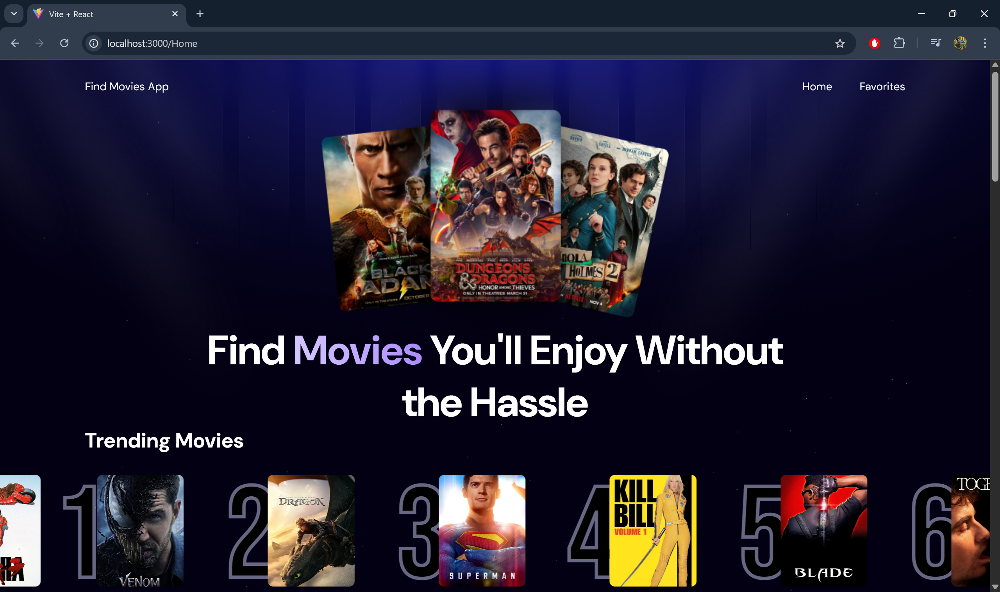
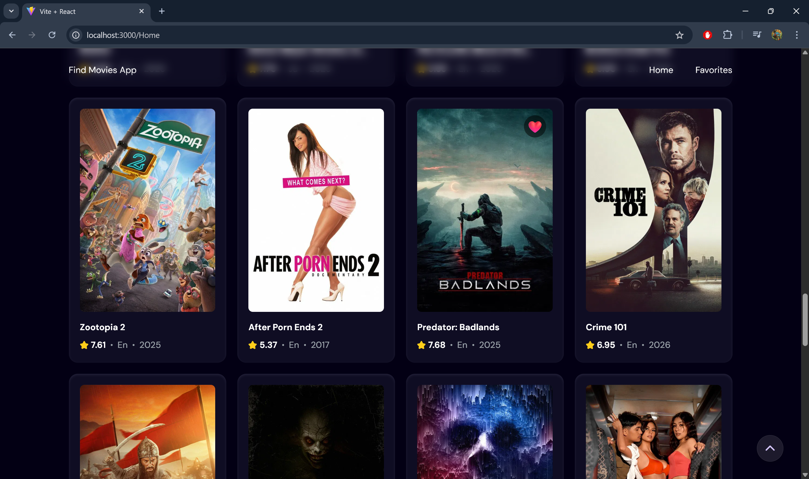
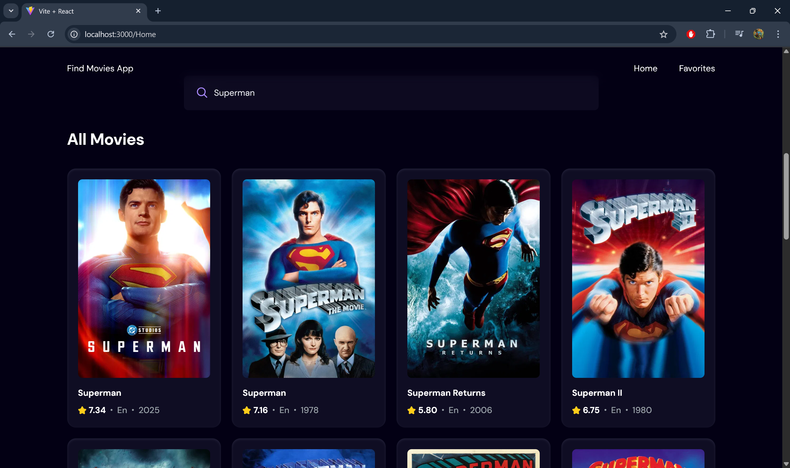
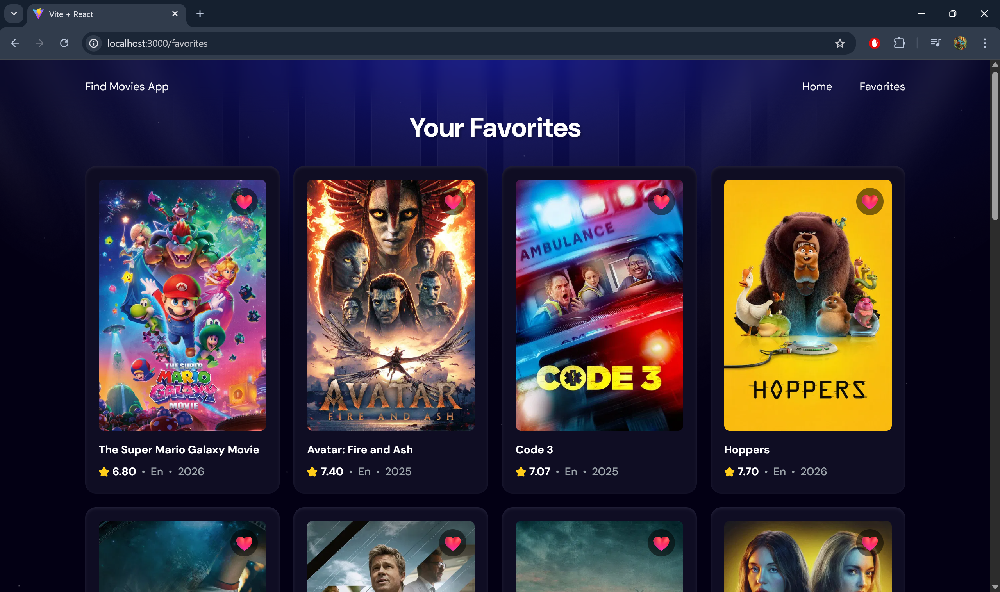
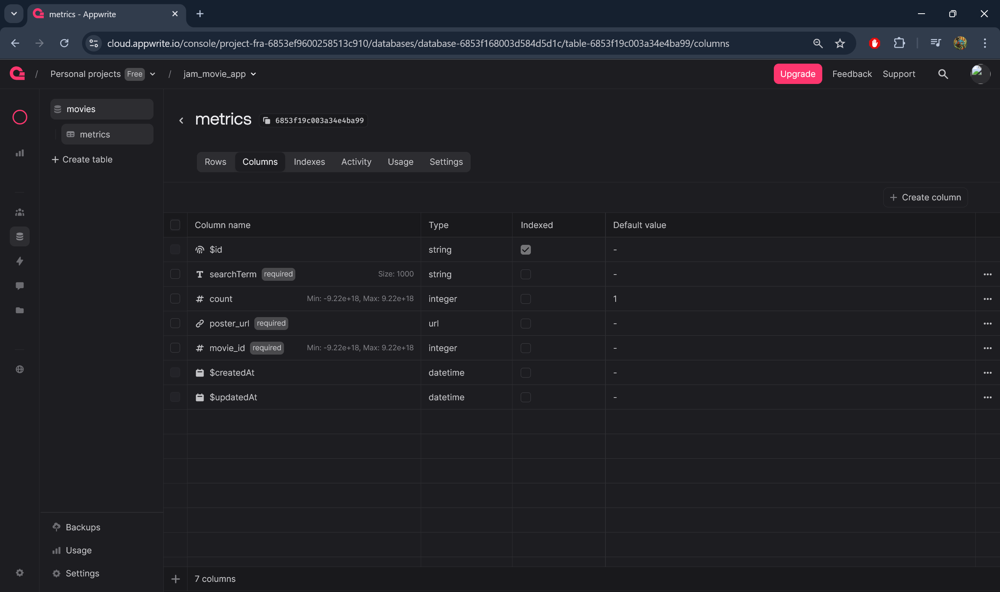
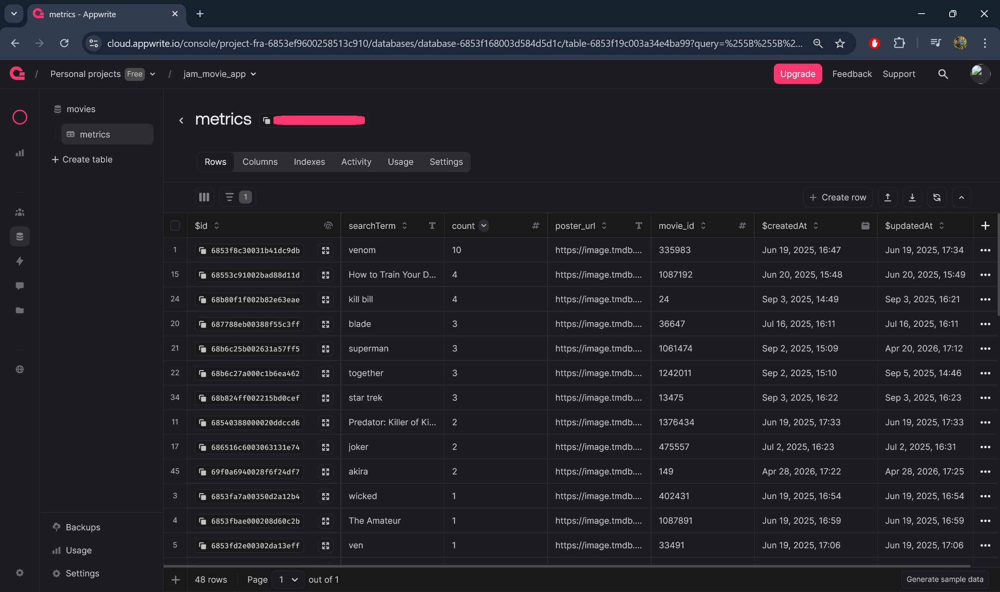

# Find Movies App

> Проект представляет собой React SPA для поиска и отслеживания фильмов на основе TMDB API и облачной базы данных Appwrite.


---

## Скриншоты интерфейса

**Главная страница**


**Карточки фильмов**


**Результаты поиска**


**Избранное**


**Созданные атрибуты для хранения в Appwrite (BaaS)**


**Собранная статистика поисковых запросов в Appwrite**


---

## О проекте

**Find Movies App** — одностраничное приложение (SPA) на React 19 и TypeScript 7 для просмотра, поиска и сохранения любимых фильмов. Каталог загружается из **TMDB API**, статистика хранится в **Appwrite**, избранное — в браузере.

Проект создан для демонстрации реальных паттернов фронтенд-разработки: интеграция с REST API, глобальное управление состоянием, постоянное хранилище данных, бесконечная пагинация, оптимизация производительности.

---

## Реализованный функционал

- **Поиск фильмов** — поисковый запрос в реальном времени передаётся в TMDB API с debounce 1 секунда
- **Фильтрация и сортировка** — три стратегии через `SortControls`: Popular (по умолчанию), Top Rated (≥10 000 голосов), Newest (уже вышедшие, ≥100 голосов)
- **Бесконечная пагинация** — подгрузка следующих страниц через `IntersectionObserver` при скролле до последнего элемента
- **Дедупликация результатов** — при пагинации фильмы схлопываются по `movie.id` через `Map`, исключая дубли
- **Избранное (Favorites)** — добавление/удаление фильмов, состояние хранится в `localStorage` через React Context и не сбрасывается при перезагрузке
- **Улучшенный UX карточек** — активная кнопка ❤️ видна всегда, неактивная 🤍 появляется при наведении (Tailwind `group/group-hover`)
- **Трендовые фильмы** — два режима через `TrendingControls`:
  - **All Time** — агрегированный счётчик поисковых запросов в Appwrite (коллекция `metrics`)
  - **Last 24h** — группировка по `movie_id` на сервере по 500 последним событиям за 24 часа
- **Бегущая строка (Ticker)** — лента трендов автоматически прокручивается с CSS `@keyframes`, дублированными элементами и остановкой при наведении
- **Состояния загрузки и ошибок** — спиннер во время запроса, осмысленные сообщения об ошибках
- **Защита от null** — фолбэк на `/No-Poster.png` при отсутствии постера
- **Статистика через Appwrite Function** — функция проверяет запрос, ограничивает частоту и возвращает только данные для отображения топа

---

## Технологический стек

| Категория | Технология |
|-----------|-----------|
| **Framework** | React 19.1 |
| **Язык** | TypeScript 7 |
| **Сборка** | Vite 6.3 |
| **Роутинг** | React Router DOM 7 |
| **Стейт-менеджмент** | React Context API |
| **Стили** | Tailwind CSS 4 (через `@tailwindcss/vite`) |
| **REST API** | TMDB API (discover/search/movie) |
| **BaaS** | Appwrite SDK 18 |
| **Утилиты** | react-use (debounce), react-doctor |
| **Линтер** | ESLint 9 (flat config) |
| **Хранилище браузера** | localStorage |

---

## Установка и запуск

### Требования

- [Node.js](https://nodejs.org/) 22.12+
- [TMDB API ключ](https://developer.themoviedb.org/reference/getting-started) (бесплатная регистрация)
- Проект Appwrite Cloud для трендов. Каталог и избранное доступны без настройки Appwrite.

### 1. Клонировать репозиторий

```bash
git clone https://github.com/r1v1an/React_19_JS_Find_Movie_DB_API.git
cd React_19_JS_Find_Movie_DB_API
```

### 2. Установить зависимости

```bash
npm install

```

### 3. Настроить переменные окружения

Создай файл `.env.local` в корне проекта:

```env
VITE_TMDB_API_KEY=YOUR_tmdb_bearer_token
VITE_APPWRITE_PROJECT_ID=YOUR_appwrite_project_id
VITE_APPWRITE_TRENDS_FUNCTION_ID=movie-trends
```

`.env.local` исключён из Git. `VITE_TMDB_API_KEY` используется только локальным Vite без Appwrite Function. Публичный сайт получает данные каталога из функции, где хранятся токен TMDB и секрет лимитера.

Шаблон доступен в файле `.env.example`.

До развёртывания функции локальный сервер Vite может работать с существующими коллекциями Appwrite. Оставьте `VITE_APPWRITE_TRENDS_FUNCTION_ID` пустой и заполните `VITE_APPWRITE_DATABASE_ID`, `VITE_APPWRITE_COLLECTION_ID` и `VITE_APPWRITE_COLLECTION_LOGS_ID`. Для этого режима нужны права чтения и записи в тестовые коллекции. Для production-сборки укажите ID развёрнутой функции.

### 4. Запустить дев-сервер

```bash
npm run dev
```

Приложение будет доступно по адресу **http://localhost:3000**

---

## Настройка трендов в Appwrite

В одной базе TablesDB нужны три таблицы. Уже созданные `metrics` и `search_logs` доступны через TablesDB по тем же ID.

### `metrics`

Для агрегации трендов «All Time». Каждый поисковый запрос увеличивает счётчик.

| Атрибут | Тип | Required | Примечания |
|---------|-----|----------|-----------|
| `searchTerm` | String | ✅ | Size: 1000 |
| `count` | Integer | ❌ | Min: -9.22e+18, Max: 9.22e+18 |
| `movie_id` | Integer | ✅ | Min: -9.22e+18, Max: 9.22e+18 |
| `poster_url` | String | ✅ | — |

Для фильтра по `searchTerm` и сортировки по `count` добавьте отдельные индексы типа Key.

### `search_logs`

Для лога каждого поискового запроса (режим «Last 24h»). Документы не обновляются, только создаются.

| Атрибут | Тип | Required | Примечания |
|---------|-----|----------|-----------|
| `searchTerm` | String | ✅ | Size: 1000 |
| `movie_id` | Integer | ✅ | Min: -9.22e+18, Max: 9.22e+18 |
| `poster_url` | String | ✅ | — |

### `rate_limits`

Создайте обязательный атрибут `count` типа Integer. За минуту функция принимает до 60 запросов каталога и 30 запросов трендов и статистики с одного IP. Записи лимитера старше двух часов удаляются по расписанию. В идентификаторе записи хранится HMAC адреса и номера минуты.

### Function `movie-trends`

1. В [Appwrite Console](https://cloud.appwrite.io/) добавьте Web-платформы для `localhost` и домена GitHub Pages, например `r1v1an.github.io`. Клиент использует регион Frankfurt (`fra`).
2. Создайте функцию с ID `movie-trends`, рантаймом **Node.js 22**, точкой входа `index.mjs` и командой сборки `npm ci --omit=dev`. Задайте **Execute access → Any**, области `rows.read` и `rows.write` для ключа функции и расписание `0 * * * *` для очистки лимитера.
3. Задайте переменные функции до её развёртывания.

| Переменная | Значение |
| --- | --- |
| `DATABASE_ID` | ID базы |
| `METRICS_TABLE_ID` | ID таблицы `metrics` |
| `SEARCH_LOGS_TABLE_ID` | ID таблицы `search_logs` |
| `RATE_LIMIT_TABLE_ID` | ID таблицы `rate_limits` |
| `RATE_LIMIT_SECRET` | Случайный секрет длиной от 32 символов |
| `TMDB_READ_ACCESS_TOKEN` | Токен API Read Access TMDB для каталога, поиска и детальной карточки |

4. Загрузите [архив функции](https://appwrite.io/docs/products/functions/deploy-manually) из `functions/movie-trends`. Следующая команда запускается из корня репозитория.

   ```bash
   tar -czf movie-trends.tar.gz -C functions/movie-trends index.mjs statistics.mjs tmdb.mjs package.json package-lock.json
   ```

5. Активируйте развёртывание, заполните `VITE_APPWRITE_PROJECT_ID` и `VITE_APPWRITE_TRENDS_FUNCTION_ID`, перезапустите Vite и проверьте оба периода трендов и новую запись поиска. После перехода всех клиентов на функцию уберите гостевые права на все три коллекции и проверьте права отдельных документов, если включена защита на уровне документов. Для новой установки создавайте коллекции закрытыми с самого начала.

## GitHub Pages

В репозитории установите **Settings → Pages → Source → GitHub Actions**, а в переменных Actions задайте `APPWRITE_PROJECT_ID`. Workflow из `master` проверяет доступность `movie-trends`, собирает приложение с `npm run build -- --mode pages` и публикует его на [GitHub Pages](https://r1v1an.github.io/React_19_JS_Find_Movie_DB_API/).

Сборка `pages` использует путь репозитория для ресурсов и маршруты с `#`, чтобы прямой переход на Favorites и обновление страницы работали на статическом хостинге.

---

## Структура проекта

```
src/
├── App.tsx                      # Корневой компонент + роутинг
├── main.tsx                     # Точка входа
├── types.ts                     # Единый источник типов
├── vite-env.d.ts                # Типы Vite env
│
├── components/                  # UI-компоненты (11 шт.)
│   ├── BackToTop.tsx            # Кнопка "наверх"
│   ├── CloseButton.tsx          # Кнопка закрытия модалки
│   ├── FavoriteButton.tsx       # Добавление в избранное
│   ├── MovieCard.tsx            # Карточка фильма
│   ├── MovieDetailsModal.tsx    # Модалка с деталями
│   ├── NavBar.tsx               # Навигация
│   ├── Search.tsx               # Поле поиска
│   ├── SortControls.tsx         # Сортировка (Popular / Top Rated / Newest)
│   ├── Spinner.tsx              # Индикатор загрузки
│   ├── Trending.tsx             # Блок трендов с ticker-лентой
│   └── TrendingControls.tsx     # Переключатель периода трендов
│
├── contexts/
│   └── MovieContext.tsx         # React Context для избранного
│
├── pages/
│   ├── Home.tsx                 # Главная (поиск, пагинация, тренды)
│   └── Favorites.tsx            # Страница избранного
│
└── services/
    ├── tmdb-api.ts              # TMDB API (fetchMovies, fetchMovieDetails)
    └── appwrite-api.ts          # Вызовы Appwrite Function
```

---

## Ключевые технические решения

- **TypeScript-first архитектура** — строгая типизация API-контрактов в `src/types.ts`: `Movie`, `MovieDetails`, `TrendingMovie`, `SortOption`, `TrendingPeriod`, `MovieContextValue`. Все сервисы и UI импортируют типы из одного источника, что исключает расхождение контрактов
- **Запись статистики** — Appwrite Function проверяет первый результат поиска в TMDB. Обновление счётчика и запись события проходят в одной транзакции. Идентификатор события защищает от повторного учёта при повторной отправке.
- **Чтение статистики** — функция агрегирует топ на сервере и возвращает ID фильма, постер и число поисков. Журнал запросов остаётся в закрытой коллекции.
- **Server-side фильтрация** — параметры `vote_count.gte` и `primary_release_date.lte` отдаются TMDB API, а не вычисляются на клиенте: для Top Rated — порог 10 000 голосов, для Newest — только вышедшие релизы с ≥100 голосами
- **IntersectionObserver + useRef** — бесконечная пагинация без сторонних библиотек; флаг `isLoading` предотвращает множественные запросы
- **Дедупликация через Map** — при дозагрузке страниц фильмы схлопываются по `movie.id` через `Map`, исключая дубликаты на стыке страниц
- **useDebounce из react-use** — отложенный поисковый запрос на 1 секунду вместо ручного `setTimeout` (проверенное решение + встроенная очистка таймера)
- **StrictMode-safe useRef** — защита от двойного срабатывания `useEffect` в режиме разработки, которая могла бы затирать `localStorage`
- **Разделение ответственности (SoC)** — логика API вынесена в `src/services/`, компоненты остаются чистыми; два сервиса (TMDB и Appwrite) не зависят друг от друга, оба импортируют только `types.ts`
- **CSS `@keyframes` вместо JS-скролла** — анимация бегущей строки трендов выполняется на compositor-потоке (60 fps), дублирование элементов обеспечивает бесшовную петлю, остановка при наведении — через `animation-play-state: paused`
- **Tailwind group/group-hover** — управление видимостью кнопки лайка без единой строки кастомного CSS: неактивная иконка появляется только при наведении на карточку

---

## Контакты

Если есть вопросы или хотите сотрудничать — пишите!

AinurSirazhev@gmail.com
